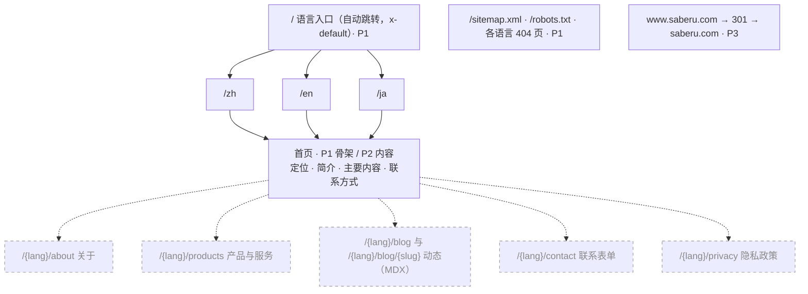
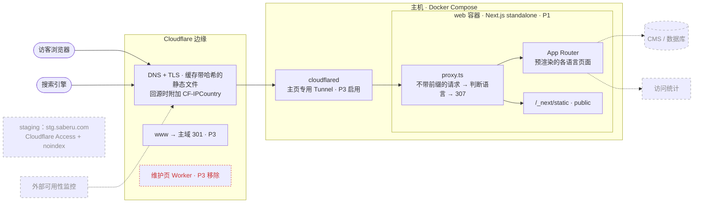
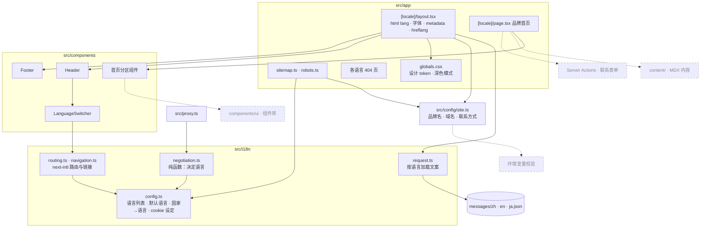
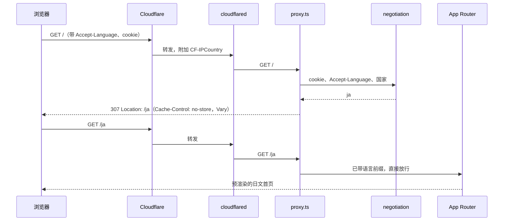
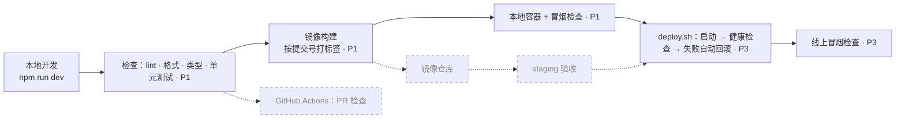

> **已过时 / SUPERSEDED — 2026-10-11**
>
> 本稿已由[当前项目设计方案](../../reviews/homepage-foundation/plan-homepage-foundation-2026-10-11.md)替代，仅保留作历史参考，不再作为实施依据。
> 下文保留原稿；其中的状态、待决事项、相对路径与环境信息均属于原稿语境。

---

# saberu.com 品牌主页：基础框架与上线

Status: DRAFT

## 目标

在 saberu.com 上线一个品牌主页，替换目前全站返回 503 的维护页。页面现在很简单，但以后要往里加内容和功能。所以本工作流先按官方入门文档和主流开源项目的惯例，搭好一个 Next.js 项目；然后填内容；最后自托管上线。

### 已确认的决定（2026-10-10，用户）

- 页面定位：品牌页，介绍 saberu 是什么、做什么、怎么联系。
- 视觉：极简排版，浅色/深色跟随系统。
- 语言：中文、English、日本語。用户原话：“我要支持多语言，根据网络以及系统语言自动适配”。
- 框架，用户原话：“当前虽然是一个简单的页面，但是我希望是基于nextjs之类的前端框架来构建。根据官方的startup页面，以及GitHub的高分项目，来构建一个恰当的框架体系，我的目的是：当前只是简单的页面，后期要添加内容和功能，所以要考虑系统设计规范。”
- 托管：选 B，自托管 Docker（standalone 镜像 + Cloudflare Tunnel），做法与 fuma-lab 相同。
- Git：同意在 `projects/homepage` 初始化独立仓库，只初始化，不提交。已于当天完成。

### 待决

1. 方案批准。用户原话：“我想先知道你是如何设计的，包括sitemap，系统架构图，各个组件的协作图等等，暂时不做的可以用虚色表示。另外多语言这部分，网址统一语言前缀是什么思路，当前的主流方案么？ 我只记得像Google是通过参数来控制的。”下文的图和“多语言网址方案”一节就是对这段话的回答。
2. 品牌文案：一句话定位、简介、主要内容（服务或产品）、联系邮箱和外链。Phase 1 先用占位文案，进入 Phase 2 前由用户提供。
3. 是否创建 GitHub 远程仓库。CI 和 Dependabot 都依赖它。

## 当前情况（2026-10-10 快照）

**项目**：`projects/homepage` 位于 workspace-meta 仓库内，但被该仓库 `.gitignore` 第一行的 `*` 忽略。它已有自己的 Git 仓库（分支 `main`，尚无提交），目录里目前只有这份方案。

**域名**：只列与主页有关的部分。〔公开前删去：与本工作流无关的其他服务说明〕
- 域名注册和 DNS 都在 Cloudflare，2029-04-09 到期，已开启 DNSSEC。
- 主域经 Cloudflare 代理，所有路径都返回 503 维护页。从响应头推断这个页面由 Worker 生成：没有 `cf-cache-status`，Content-Type 的写法也和 Worker 示例代码一致；作为对照，同样经过代理的源站会带 `cf-cache-status: DYNAMIC`。它挂在 Worker 路由上还是 Custom Domain 上，要到控制台确认。
- `www` 没有 DNS 记录。Universal SSL 覆盖 `saberu.com` 和 `*.saberu.com`。
- 邮件相关记录（MX、SPF、DKIM、DMARC、autodiscover/autoconfig）不在本工作流范围内。主域的 A/AAAA 记录不在 SPF 的 `a` 机制里，所以替换它们不影响发信校验。

**技术事实**：均于 2026-10-10 查阅一手资料，来源见文末。升级依赖或部署前要复查。
- Next.js 最新稳定版是 16.4.0（2026-10-06）。官方预告 2026-10-14 发布安全更新，修复上游依赖中两个 Critical、一个 High 级别的漏洞。自托管会直接运行 Next 服务器，所以这次更新与本项目直接相关。
- create-next-app 16.4 的默认选项：TypeScript、ESLint、Tailwind CSS、App Router、开启 Cache Components、生成 AGENTS.md，不使用 `src/`。
- Next 16 把 `middleware` 改名为 `proxy`，只在 Node.js 运行时执行；`next build` 不再运行 lint。
- next-intl 4.14.9 支持 Next 16 和 `proxy.ts`。在 16.3 及以上版本，它可以用 `next/root-params` 加 `generateStaticParams` 预渲染全部语言页面。
- 语言判断：
  - W3C 和 Google 都建议不要主要靠 IP 判断语言。
  - Google 建议每种语言用不同的网址，并只对不带语言前缀的首页自动跳转，把它标为 `x-default`。
  - Google 把 URL 参数方案（`?loc=de`）明确标为“不推荐”。
- 同一主机名上，Cloudflare Workers 路由优先于源站，也优先于 Custom Domain。

**本机与先例**：
- 主机〔名称公开前删去〕上有 Node 24.14.1、npm 11.11.0 和 Docker。
- 缺少无头浏览器所需的系统库，浏览器测试要放在 Playwright 官方容器里跑。
- fuma-lab 的做法：standalone 镜像、非 root 用户、只读根文件系统、只监听本机回环地址，再用 cloudflared 对外。staging 用容器化的 Tunnel，token 放在被 Git 忽略的 env 文件里；部署脚本带健康检查和自动回滚。

## 方案

图例：实线是本方案要做的，标注 P1/P2/P3 表示所在阶段；虚线是以后扩展，不在本方案内；红色虚线是要移除的。

### 网站地图



`/sitemap.xml` 由 `src/app/sitemap.ts` 生成：每个页面的三种语言各占一条，并在每条里写明另外两种语言的地址（hreflang alternates）。以后新增页面时，在同一份路由清单里登记即可。

### 系统架构（运行时）



- `web` 容器只接入 Compose 内部网络，不映射公网端口。本地验证时，额外映射到 `127.0.0.1`。
- `cloudflared` 使用主页专用的 Tunnel，token 由被 Git 忽略的 env 文件注入。Tunnel 由主机主动向外连接，主页不需要主机开放任何入站端口。
- HTML 在 Cloudflare 默认不缓存，每次访问都回源。`/_next/static/*` 带内容哈希，可以长期缓存。
- 维护页必须在切换前移除，因为 Worker 路由优先于源站，不移除的话请求到不了 Tunnel。

### 应用模块与协作



各模块的职责边界：
- 语言规则只有一个来源，即 `src/i18n/config.ts`，包括支持的语言、默认语言、国家到语言的映射和 cookie 名称与有效期。修改语言策略只改这里。
- `negotiation.ts` 是不依赖 Next 的纯函数，可以单独测试；如果以后把语言判断移到边缘或别的入口，也能直接复用。
- 品牌常量（名称、域名、联系方式）只放在 `site.ts`。需要翻译的文字放在 `messages/`。
- 页面通过组件引用设计 token，不直接写颜色值。

### 关键流程

**首次访问 `/`：**



**切换语言**：用户在切换器里选择中文后，浏览器写入 cookie `NEXT_LOCALE=zh`（有效期一年），然后打开当前页面的 `/zh` 版本。以后再访问 `/`，proxy 读到这个 cookie，就跳到 `/zh`。只是访问某个语言的页面，不会改写 cookie。

**搜索引擎**：Googlebot 默认从美国 IP 抓取，请求里不带 Accept-Language。它访问 `/` 时会被跳转到 `/en`，然后从 hreflang 中拿到 `/zh`、`/ja` 和 `x-default=/`，再直接抓取这两个页面。带前缀的页面都返回 200，不会被跳转，所以三种语言可以分别收录。

### 多语言网址方案

几种常见做法，都是“每种语言一个独立网址”：

| 做法 | 实际例子（2026-10-10 访问） | Google 搜索中心的评价 |
|---|---|---|
| 路径前缀（子目录） | `apple.com/jp/`、`developer.mozilla.org/ja/`、`learn.microsoft.com/ja-jp/`、`cloudflare.com/ja-jp/`、`docs.github.com/ja`、`stripe.com/jp` | 易搭建；同一主机，维护成本低 |
| 子域名 | `ja.react.dev`、`zh-hans.react.dev` | 易搭建，可以分服务器 |
| 国家域名 | `example.de` | 地域定向最清楚，但成本高 |
| URL 参数 | `developers.google.com/...?hl=ja` | 明确标为“不推荐”：难以按网址分组，用户从网址看不出语言 |
| 网址不变，只看 cookie 或浏览器设置 | — | 不建议；Google 要求每种语言使用不同网址 |

你记得的“Google 用参数”是对的：Google 自家文档用 `?hl=ja`，而且每个带参数的网址各自是 canonical。但 Google 给网站作者的指南并不推荐这种做法。新站用路径前缀是主流。

路径前缀又分两种：

| 做法 | 根路径 `/` 的行为（日文浏览器实测） | 例子 |
|---|---|---|
| 默认语言不带前缀 | 直接显示英文站，不跳转；其他语言要手动进入 | apple.com、stripe.com |
| 所有语言都带前缀 | `/` 只作语言入口，按浏览器语言 302 到 `/ja/` | developer.mozilla.org、learn.microsoft.com |

本方案用第二种，原因如下：
- 你要求按网络和系统语言自动适配，所以 `/` 必须承担“判断后跳转”的职责。如果英文页就放在 `/`，同一个网址既要显示英文、又要把别的访客送走，两件事冲突。
- 统一前缀后，每个语言页的网址固定，可分享、可缓存，不会因访客不同而变化。`/` 在 hreflang 里标为 `x-default`，这正是 Google 推荐给“自动跳转首页”的标注方式。
- Next.js 官方 i18n 指南（`app/[lang]`）和 next-intl 的默认配置（`localePrefix: 'always'`）都采用这种做法。

### 语言判断规则

1. 网址已带语言前缀：使用该语言，不跳转。
2. cookie `NEXT_LOCALE`：表示用户在切换器里选过。
3. Accept-Language，即浏览器或系统的语言，按 best fit 匹配 zh、en、ja。
4. 访客所在国家（`CF-IPCountry`）：CN、SG、TW、HK、MO 对应 zh，JP 对应 ja。只有前三步都没有结果时才用。`XX`（未知）和 `T1`（Tor）不参与判断。
5. 默认 en。

所以人在日本、浏览器设为中文的访客会看到中文。国家映射是可调整的策略数据，放在 `src/i18n/config.ts`。TW、HK、MO 暂时对应简体中文，是否调整由用户决定。

### 技术选型

**框架**
- Next.js 16.4.x，上线前升级到 10-14 的安全更新版本。App Router，TypeScript strict，使用 `src/` 目录，构建器为默认的 Turbopack。
- Cache Components 保持开启：它是 16.4 新项目的默认，也将成为 Next 17 的默认。页面全部预渲染。如果与 next-intl 冲突，就关闭它并记录原因。React Compiler 暂不开启。

**多语言**
- 用 next-intl 4.x，设置 `localePrefix: 'always'`，配合 `next/root-params` 和 `generateStaticParams`。
- 文案放在 `messages/*.json`，键名做类型检查；另写测试，保证三份文件的键完全一致。
- `proxy.ts` 只处理不带语言前缀的请求：调用 negotiation 判断语言，然后 307 跳转；带前缀的请求直接放行。

**样式**
- Tailwind CSS v4，设计 token（颜色、字号、间距）集中写在 `globals.css`。
- 深色模式用 `prefers-color-scheme` 实现，不需要 JavaScript。
- 字体：拉丁字母用 Geist，通过 `next/font` 自托管；中文和日文按 `:lang()` 使用系统字体栈。
- 组件库等到需要第一个复杂交互组件时再引入。

**SEO**
- `metadataBase` 取自 `site.ts`。
- 每个语言页都有 canonical，并输出三种语言加 `x-default` 的完整 hreflang 互链。
- 另有 `sitemap.ts` 和 `robots.ts`。

**安全**
- 在 `next.config` 的 `headers()` 里设置基础安全响应头：`X-Content-Type-Options`、`Referrer-Policy`、`Permissions-Policy`，以及 `frame-ancestors` 限制。
- HSTS 由 Cloudflare 边缘负责。目前它是 `max-age=0`，等上线稳定后再评估。

**容器**
- 多阶段 Dockerfile，参照 fuma-lab：standalone 产物、非 root 用户、只读根文件系统，`.next/cache` 用 tmpfs，并配置健康检查。
- `compose.yaml` 定义 `web` 和 `cloudflared` 两个服务。`cloudflared` 到 Phase 3 才启动。

**工程工具**
- 包管理用 npm，与用户现有项目一致。
- ESLint 9 + eslint-config-next + Prettier。eslint-config-next 内置的插件还不支持 ESLint 10；TypeScript 也要保持在 typescript-eslint 支持的范围内。
- 测试用 Vitest；Playwright 在官方容器里运行。
- GitHub Actions 配置包括 lint、格式、类型、单元测试、构建、镜像构建和冒烟检查；Dependabot 每周分组更新。这些配置要等远程仓库建好才会生效。

**代理说明**
- `AGENTS.md` 是唯一来源，`CLAUDE.md` 只写 `@AGENTS.md`。
- 保留 Next 自动维护的那一段，它指向与当前版本对应的文档。

### 目录结构

```text
src/proxy.ts              语言入口判断（Next 16 的 proxy）
src/app/[locale]/         各语言页面与根布局
src/app/                  sitemap.ts、robots.ts、globals.css、全局 404
src/components/           页眉、页脚、语言切换器、首页分区；ui/ 留给以后
src/config/site.ts        品牌常量
src/i18n/                 config、negotiation、routing、request、navigation
messages/                 zh.json、en.json、ja.json
tests/                    unit/、e2e/
scripts/                  smoke.mjs（本地和线上共用）；deploy.sh（Phase 3）
Dockerfile、compose.yaml、envs/*.env.example
docs/                     architecture.md（实现后补）、reviews/<主题>/plan 与 changelog
tmp/                      本地临时文件，Git 忽略〔主机细节公开前删去〕
```

### 构建与发布



## 阶段

**Phase 1：基础框架（全部在本地）**

用 create-next-app 生成项目（目录已是 Git 仓库，生成器不会再初始化 Git），然后：
- 第一步就构建验证 Cache Components、`next/root-params` 与 next-intl 能否一起工作；
- 接入多语言和 proxy；
- 建设计 token 和页面骨架，首页放三语占位文案；
- 补齐 SEO、安全头、测试；
- 写 Dockerfile 和 compose（只启动 `web`）；
- 写 CI 和 Dependabot 配置；
- 写文档（README、AGENTS.md、CLAUDE.md、architecture.md）。

完成标准：下方验收表中的本地检查全部通过，包括对本地容器的冒烟检查。整个阶段不提交 Git。

**Phase 2：填内容**

用户提供品牌文案后，填写三语内容，补 favicon 和 OG 图，然后一起审阅页面。

**Phase 3：上线（受保护操作，需要用户单独确认）**

前提条件：
- Next 已升级到 10-14 安全更新后的版本，并在新版本上重跑所有检查；
- 已在控制台确认维护页的配置；
- 主页专用 Tunnel 和它的 token 已准备好；
- 已有修改 DNS 所需的 Cloudflare 授权。

每一步执行前，我都会给出操作说明（目标、影响、恢复方式），等用户确认：
1. 启动容器；
2. 把主域指向 Tunnel，替换现有的 A/AAAA 记录；
3. 移除维护页的 Worker 路由；
4. 建 `www` 记录并配置 301 跳转；
5. 线上冒烟检查。

恢复办法：回到上一个镜像标签，或者恢复原来的 DNS 记录和维护页路由。

## 验收

| 条件与动作 | 应看到的结果 | 验证方式 |
|---|---|---|
| 无 cookie；Accept-Language `ja-JP`；访问 `/` | 307 跳到 `/ja` | proxy 单元测试，加对本地容器的冒烟检查 |
| 无 cookie；Accept-Language `zh-CN,en;q=0.8`；国家 JP | 跳到 `/zh`（浏览器语言优先于国家） | 单元测试 |
| 无 cookie；Accept-Language `fr`；国家 JP | 跳到 `/ja`（按国家兜底） | 单元测试 |
| 无 cookie；没有 Accept-Language；国家为 `XX` 或 `T1` | 跳到 `/en` | 单元测试 |
| cookie 为 `zh`；Accept-Language 为 `ja` | 跳到 `/zh`；cookie 值非法时忽略 cookie | 单元测试，加冒烟检查 |
| 直接访问 `/ja` 等带前缀的地址 | 200，不跳转 | 冒烟检查 |
| 访问不带前缀的其他路径，如 `/about` | 307 跳到对应语言下的同一路径 | 单元测试，加冒烟检查 |
| 任一语言页 | `<html lang>` 正确；canonical 正确；三语 hreflang 互相链接，含 `x-default` | 冒烟检查（解析 HTML） |
| `/sitemap.xml` 和 `/robots.txt` | 两者都存在；sitemap 带三语 alternates | 冒烟检查 |
| 访问不存在的路径 | 返回 404 页，使用对应语言 | 冒烟检查 |
| 任一响应 | 带有约定的安全响应头 | 冒烟检查 |
| 在切换器中选日语 | 跳到当前页的 `/ja` 版本；之后访问 `/` 进入 `/ja` | Playwright |
| 系统设为深色模式 | 页面使用深色 token，文字可读 | Playwright 截图，加人工查看 |
| 三份文案文件 | 键完全一致 | 单元测试 |
| 运行容器 | 以非 root 用户运行；根文件系统只读；健康检查通过 | 检查容器配置，加冒烟检查 |
| 全部代码 | lint、格式、类型检查、构建都通过，没有未解释的新警告 | 在本地运行与 CI 相同的命令 |

## 范围外

- 部署、DNS、Tunnel 和 Cloudflare 配置变更，属于 Phase 3，要单独确认
- 邮件和 MX 修复
- 其他子域
- staging 环境、CMS、博客/MDX、联系表单、统计分析、登录、数据库
- Git 提交、推送，以及创建远程仓库

## 风险与应对

- **主页可用性与这台主机绑定。** 这台主机上还运行着其他服务〔细节公开前删去〕。应对：容器配置重启策略和健康检查；上线后可视需要增加外部可用性监控。
- **Next 服务器直接对外。** 应对：上线前必须升级到 10-14 的安全更新版本；之后由 Dependabot 持续跟进更新。
- **`CF-IPCountry` 依赖 zone 开启 IP Geolocation。** 应对：上线时验证。如果拿不到这个头，就退回按 Accept-Language 和默认语言判断，主要功能不受影响。
- **维护页的 Worker 路由会拦截全部请求。** 应对：Phase 3 先确认并移除它，再判断切换是否生效。
- **Cache Components、`next/root-params` 与 next-intl 的组合尚未经构建验证。** 应对：Phase 1 第一步就构建验证。备选做法是关闭 Cache Components，改用 `setRequestLocale`。

## 主要来源

- Next.js：
  - [16.4 发布说明](https://nextjs.org/blog/next-16-4)
  - [安全更新预告](https://nextjs.org/blog/upcoming-nextjs-security-update-october-2026)
  - [安装](https://nextjs.org/docs/app/getting-started/installation)
  - [项目结构](https://nextjs.org/docs/app/getting-started/project-structure)
  - [i18n 指南](https://nextjs.org/docs/app/guides/internationalization)
  - [proxy](https://nextjs.org/docs/app/api-reference/file-conventions/proxy)
  - [root params](https://nextjs.org/docs/app/api-reference/functions/next-root-params)
- next-intl：
  - [routing 配置](https://next-intl.dev/docs/routing/configuration)
  - [proxy](https://next-intl.dev/docs/routing/middleware)
- 网址结构与语言判断：
  - [Google 多区域多语言站点](https://developers.google.com/search/docs/specialty/international/managing-multi-regional-sites)
  - [Google hreflang](https://developers.google.com/search/docs/specialty/international/localized-versions)
  - [W3C 语言协商](https://www.w3.org/International/questions/qa-when-lang-neg.en)
- Cloudflare：
  - [Routes](https://developers.cloudflare.com/workers/configuration/routing/routes/)
  - [CF-IPCountry](https://developers.cloudflare.com/fundamentals/reference/http-headers/#cf-ipcountry)
  - [Tunnel](https://developers.cloudflare.com/cloudflare-one/networks/connectors/cloudflare-tunnel/)
