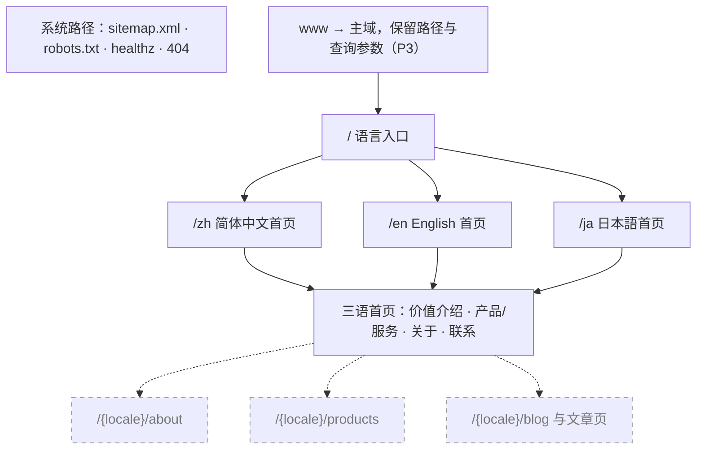
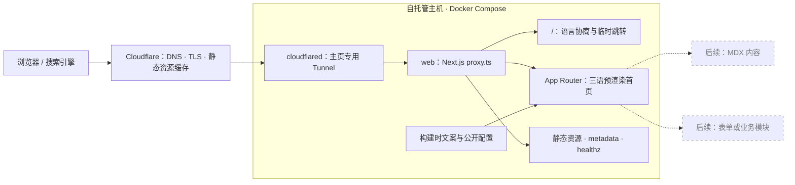
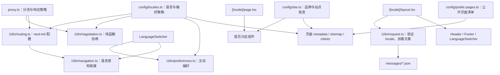
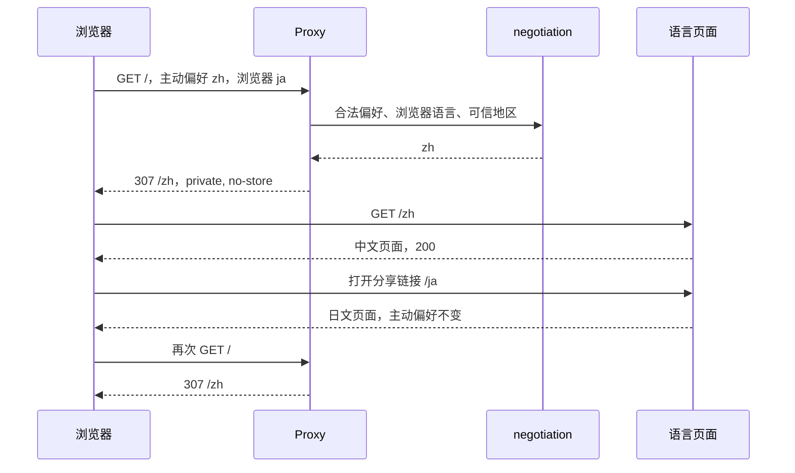
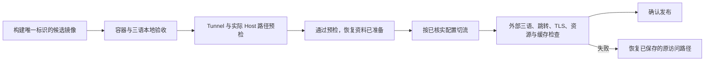

# saberu.com 品牌主页：项目设计方案

Status: APPROVED（批准范围：2026-10-11 P1 本地实施；2026-10-12 增加 P2 demo 内容起草与仓库/CI 工程框架的本地文件，并决定建立公开仓库、以初始导入为首次提交，执行以经确认的受保护操作说明为准；2026-10-12 决定 P3 的 Cloudflare 侧变更经 [Cloudflare 配置代码化方案](../cloudflare-config/plan-cloudflare-config-2026-10-12.md)执行；2026-10-13 决定 P2 demo 视觉改以 Velora UI 为基础、在第 6 节约束内实施，配色用 Velora Blue，取代同日以 Vercel Portfolio Blog Starter 为基础的决定，博客延后；2026-10-14 决定定位改为可长期演进的通用品牌网站，首页区块改由配置决定并先实施，模板现阶段用免费开源版、后期可改用付费版并届时把仓库改为私有；此后的发布与 P3 另行授权）

本文件是主页基础建设工作流唯一的当前方案，替代两份旧方案；P1 本地实施已获授权，发布与上线尚未执行。

## 文档决定与范围

2026-10-11（Asia/Tokyo），用户要求：“按照建议，再做一份新的，将现有的纳入已过时资料”。本次授权为整合设计与归档旧稿；不视为批准实施或上线。两份原稿及迁移关系保存在[已过时资料](../../archive/homepage-foundation/README.md)。

2026-10-11（Asia/Tokyo），用户指示：“继续推进当前项目”。此时本方案只剩“是否开始 P1 实施”待用户授权，故将该指示记录为批准 P1 本地工程实施：在本仓库工作区创建应用代码、配置、测试与容器定义，并执行本地检查、生产构建与本地容器验证。该授权不包含 Git 暂存、提交、推送或远程仓库创建，不包含部署、Cloudflare、DNS 或主机配置变更，也不包含 P2 品牌内容确认与 P3 切流；这些仍按第 7、8 节另行授权。若此解释不符合用户意图，删除工作区中新增的应用文件即可恢复为纯设计资料。

2026-10-12（Asia/Tokyo），用户对 P1 交付后的五项待决事项答复如下，原话照录：

1. 依赖版本：“为什么要锁版本，常规做法不是锁大版本么？安全更新必须纳入考虑”。决定：`package.json` 采用锁定主版本的范围（`^`），由 `package-lock.json` 锁定实际解析结果；安全更新通过自动依赖更新、审计门槛和框架安全版本的升级流程纳入。
2. P2 内容：“请用demo方式给出一份，邮箱用contact@saberu.com”。决定：联系邮箱确定为 `contact@saberu.com`；访客定位、文案、主要行动、图标与分享图由代理起草 demo 版本。demo 不构成第 7 节 P2 进入条件中的内容确认，品牌负责人确认前不得发布。
3. 远程仓库与 CI：“要，当前虽然没什么功能，但是框架要符合当前主流的开发，以便后续开发或者功能扩展时候不需要考虑这个”。决定：建立远程仓库与 CI，工程框架按当前主流做法配置。CI、依赖更新等配置文件先在本地工作区完成；远程仓库的所有者、名称与可见性属于受保护的外部写入，执行前另行确认。
4. 提交时机：“还没到提交的阶段，至少得真的需要提交了才行，初始的时候可以0.0.1”。决定：确有需要之前不提交；起始版本号为 `0.0.1`，发布标签沿用工作区默认格式 `v0.0.1`。
5. 开发期审计项（`braces` 经 lint 工具链引入，上游无修复版本）：“按照推荐做法来”。决定：按推荐做法处理：生产依赖审计零容忍并作为阻断门槛，无修复的开发期公告经评估后以带复核期限的书面例外放行，并自动复查。

2026-10-12（Asia/Tokyo），用户对远程仓库可见性与时机的答复，原话照录：“按你的建议，公开仓库，现在就建”。决定：建立公开仓库 `taoziyoyo2566/saberu-homepage`，以初始导入作为首次提交并推送；按 `docs/development.md` 配置仓库的安全功能与 `main` 的规则集，分支、提交与合并约定同时写入项目文档。创建、提交与推送都是受保护操作，执行以提交给用户确认的操作说明为准。准备时发现，归档的 2026-10-10 原稿含主机名、主机上其他服务的描述和未处理问题的提示，验证记录的环境快照也含主机名；此前答复中"验证记录里的主机名是仓库中唯一的主机标识"的说法有误。操作说明建议在首次提交前删去这些细节。

2026-10-12（Asia/Tokyo），用户提出由本仓库的配置管理 Cloudflare 一侧，并对编码助手的 Terraform 建议答复：“同意”。决定：P3 在 Cloudflare 侧的变更（主页 Tunnel、DNS 切换、`www` 跳转、移除维护页挂载）经独立工作流 [Cloudflare 配置代码化方案](../cloudflare-config/plan-cloudflare-config-2026-10-12.md)的配置与流程执行，每次执行逐次授权；P3 的进入条件、检查点与恢复目标仍以本方案第 7 节为准。saberu.com 的 Cloudflare 现状见[现状调查记录](../cloudflare-config/investigation-cloudflare-current-state-2026-10-12.md)。

2026-10-13（Asia/Tokyo），以下两项决定由另一会话记入工作树 `feat/portfolio-starter-design` 的方案副本；该副本未提交，不会并入，故在此照录。用户否定 P2 demo 的视觉，原话照录：“https://portfolio-blog-starter.vercel.app/ 我想用这个template做一个homepage，你给出的太难看了。要做到符”（消息在此中断），随后补充：“可以参考这个ChatGPT给出的结果”。该会话据此决定 P2 demo 视觉改用 Vercel 官方模板 Portfolio Blog Starter 的版式；此决定已由本节下文取代。同日用户答复博客问题，原话照录：“博客以后再做，先把首页做好看”。决定（仍有效）：本次只做首页视觉，第 2 节所列的博客延后，开始做博客时再定范围与三语策略。待用户补充（不阻塞）：中断的后半句“要做到符…”所指的要求。

2026-10-13（Asia/Tokyo），用户认为 P2 demo 的页面"太难看了"，要求调查 ChatGPT 推荐的 Next.js 模板。编码助手核对候选的许可证、版本与维护情况并对比截图后，推荐以 Velora UI（`ColorlibHQ/velora-ui`，MIT 许可）为参考和区块来源。用户答复，原话照录：“就用 Velora UI，开分支开始做”。决定：P2 demo 视觉改以 Velora UI 的设计与区块为基础，在分支 `feat/visual-redesign` 上实施。实施遵守第 6 节：不引入组件库或客户端动画库，只把所需区块的结构与样式移植到现有组件；动效用 CSS 实现并遵守减少动效设置；没有 JavaScript 时正文与联系方式仍可读、可用。第 2 节的页面结构，以及第 4、5 节的契约不变。改版期间可在本机预览中切换几套配色作比较；选定后只保留一套，并保留浅色与深色。

同日用户在本机预览中比较配色后答复，原话照录：“用 Velora Blue，取代另一个分支”。决定：配色采用 Velora Blue（取值以 `src/app/globals.css` 为准），删除临时的配色切换；Velora UI 方向取代上文以 Vercel Portfolio Blog Starter 为基础的决定，按那个方向改版的分支 `feat/portfolio-starter-design` 不再作为合并候选。

2026-10-14（Asia/Tokyo），编码助手复核 ChatGPT 第二轮模板调查后（该结果把网站扩展为可长期演进的通用品牌网站、区块可配置），询问定位是否改变、是否付费。用户答复，原话节选：“是的，定位改成通用品牌网站，先做区块配置化.如果选择收费版，自然不会变成公开项目……现阶段可以暂时考虑开源版，后期为了稳定性和减少维护成本考虑付费版，所以是不是优先看付费版，但是暂时用他的免费版先用着”。决定：

1. 定位：saberu.com 从品牌主页改为可长期演进的通用品牌网站，当前展示品牌与业务，以后按需要增加产品、服务、项目、文档等内容。这是对第 1、2、4 节已批准内容的变更，由用户此次答复批准，相应段落已修订；第 1 节不引入 CMS 等边界，以及第 4、5 节的三语路由、SEO、404 与偏好契约不变。
2. 先做区块配置化：首页显示哪些区块、顺序如何、哪些进入导航，由一份配置决定；区块按版式分类型，同一类型可承载不同内容。配置随代码审阅修改，不做在线后台。实施在分支 `feat/configurable-sections`。
3. 模板策略：现阶段用免费开源版；后期为稳定性和降低维护成本考虑付费版，选用付费版时仓库改为私有。选型优先看同时提供免费版和付费版的产品线，先用其免费版。Velora UI 的 README 写明整个产品免费（MIT），没有付费版，所以这条路线要另选产品线；选定之前继续使用当前视觉。影响：改为私有仓库之前，要另行核对 GitHub 私有仓库可用的规则集与代码扫描功能。

## 1. 目标与当前基础

建设 saberu.com 的中文、英文、日文品牌主页，让访客能够理解品牌提供什么，并找到产品或联系方式。第一版交付一个完整首页，随后按真实需求增加公开内容和交互功能。2026-10-14 起定位为可长期演进的通用品牌网站：先交付首页，再按需要增加产品、服务、项目、文档等内容（见“文档决定与范围”）。

沿用原方案记录的产品方向：Next.js 框架、极简排版、跟随系统的浅色/深色主题、多语言自动适配，以及 Docker standalone + Cloudflare Tunnel 自托管。本文统一此前冲突的路由、Cookie、配置归属和发布验收约定，具体技术设计仍为待批准草案。

编写本方案时，本仓库只有设计资料和 `.gitignore`，独立 Git 仓库尚无提交，没有应用代码、依赖锁文件或运行验证。旧稿中的域名、主机工具版本、维护页来源与其他项目先例是历史信息；本方案不将其视为已核实的当前环境。P1 检查本地开发条件，P3 再检查实际部署主机和 Cloudflare 配置。

| 阶段 | 交付结果 | 本阶段不承担的工作 |
|---|---|---|
| P1 基础框架 | 可运行的三语首页骨架、语言行为、SEO、测试与本地容器 | 真实品牌内容、对外切流 |
| P2 内容与体验 | 可发布的三语内容、视觉、图标与分享图 | 登录、CMS、联系表单后台 |
| P3 发布与恢复 | 已验证的线上主页、可执行恢复步骤 | 多主机高可用、复杂发布平台 |

本期不引入数据库、登录、Dashboard、全局状态库、CMS、自动翻译、访问统计或独立 staging 平台。新增内容页面沿用现有路由和组件；新增业务能力时再设计数据、权限与运行边界。

## 2. 产品结构与页面雏形

暂定主要访客是首次了解 saberu 的潜在用户或合作方。首页的任务是依次回答“做什么、对我有什么用、在哪里进一步了解、如何联系”。这是设计假设，P2 开始时由品牌内容确认。

推荐主要行动为“联系 saberu”，先使用真实邮箱链接；产品有可用入口时增加“查看产品”作为次要行动。若用户确认以产品访问为主要目标，则在 P2 调整行动顺序，不增加业务后台。

```text
┌──────────────────────────────────────────────┐
│ saberu         产品 / 关于 / 联系    语言选择 │
├──────────────────────────────────────────────┤
│ 一句话价值主张                               │
│ 对谁有用、提供什么、有什么特点               │
│ [联系 saberu]  [查看产品（有入口时）]         │
├──────────────────────────────────────────────┤
│ 主要产品或服务：名称、价值、状态、真实入口    │
├──────────────────────────────────────────────┤
│ 关于 saberu：简短背景、已有成果或可信外链    │
├──────────────────────────────────────────────┤
│ 联系方式与外链                              │
├──────────────────────────────────────────────┤
│ 页脚：品牌信息                               │
└──────────────────────────────────────────────┘
```

首页由区块组成：显示哪些区块、顺序如何、哪些进入导航，由区块配置决定（第 4 节）；上图是当前配置的组合。导航跳到首页区块；没有真实内容的区块在配置中关闭，它的导航链接随之消失。P1 可用明显的占位内容验证布局，P2 必须替换，不编造客户、成果、评价或产品能力。三种语言共用相同结构，允许翻译后的文字长度不同。

### 网站地图

实线表示本期，虚线表示后续可能增加的页面；未来页面不进入当前导航或 sitemap。



## 3. 系统架构与职责



- Cloudflare 负责公网入口；Tunnel 连接 web 服务。web 不暴露公网端口，本地验证按需绑定 `127.0.0.1`。容器间使用专用 Compose 网络，cloudflared 保留出站连接能力。
- Next.js 同时承载页面和少量入口逻辑，不另建后端服务。页面内容优先预渲染；服务器运行不等于每次请求都重新渲染内容。
- 页面默认使用服务端组件；语言切换中记录偏好、维持滚动等浏览器行为局部使用客户端组件。深色模式由 CSS 跟随系统，不引入主题状态库。
- 首版 Cloudflare 保持 HTML 不作共享边缘缓存；带哈希的静态资源可长期缓存。Next 的预渲染缓存与 Cloudflare CDN 缓存分别验证。以后开启 HTML CDN 缓存时再评估 RSC、预取响应与缓存键，不能直接套用“缓存全部”。

### 模块协作



语言和页面事实各有一个数据来源；`routing.ts` 从语言配置派生库配置，不能再手写第二套语言列表。页面清单用于导航、SEO 与路由测试，不额外实现一个替代 Next 文件路由的路由器。

### 目标目录

```text
src/
  app/
    [locale]/
      layout.tsx          语言根布局，包含 html/body
      page.tsx            共用首页
      not-found.tsx       本地化错误展示，配合未知路径处理
    healthz/route.ts      无敏感信息的进程响应检查
    sitemap.ts
    robots.ts
    globals.css
  components/             页面框架、分区、LanguageSwitcher
  config/                 locales.ts、site.ts、public-pages.ts
  i18n/                   routing、navigation、request、negotiation、preferences
  proxy.ts
messages/                 zh.json、en.json、ja.json
tests/                    unit/、e2e/
scripts/                  smoke.mjs；P3 增加发布与恢复工具
public/                   图标、分享图等公开资源
Dockerfile、compose.yaml、package.json、package-lock.json
docs/                     当前方案、实施后运行说明与历史资料
```

当前采用 `[locale]/layout.tsx` 作为页面根布局，保证 locale 是 `next/root-params` 可读的根参数。不为增加错误页随意新增其上层 `app/layout.tsx`；错误页的具体路由文件在 P1 最小原型中验证后确定。`/healthz` 是 Route Handler，不需要新增页面根布局。

## 4. 内容与配置契约

| 唯一来源 | 管理内容 | 校验与生效方式 |
|---|---|---|
| `config/locales.ts` | 语言 ID、标签、名称、默认语言、国家兜底映射、偏好 Cookie 名与期限 | 语言 ID 唯一；默认值和映射目标必须已注册；构建前校验 |
| `config/site.ts` | 品牌、主域、邮箱、公开外链 | P1 允许标记占位；P2 发布校验拒绝占位、非法 URL 和缺少的主要联系入口 |
| `config/home.ts` | 首页区块：实例 ID、版式类型、是否启用、是否进入导航，以及版式参数（如卡片图标） | ID 唯一；恰有一个启用的首屏区块且排在第一；启用的区块在每种语言都有其版式所需的文案，进入导航的还有导航名；不符合时检查失败 |
| `config/public-pages.ts` | 可索引公开页面及导航信息，首版只有首页 | 路径唯一；清单与实际页面通过测试核对；未发布页面不得进入 sitemap |
| `messages/*.json` | 首页、语言切换、错误提示与 metadata 的翻译 | 键一致、必填非空、ICU 语法及插值参数兼容；错误使检查失败 |
| `globals.css` | 颜色、字号、间距、焦点与浅深色 token | 页面使用 token；通过三语、主题与窄屏检查 |

这些配置由项目维护者通过代码审阅修改，文案由品牌负责人校对；变化经检查、重新构建和发布后生效。当前不需要在线配置后台。仓库配置非法时停止构建，不能静默替换；访问者提交的非法 Cookie、语言头或地区值按下节规则忽略。后续发布可通过恢复上一已验证镜像恢复其对应的公开配置与文案。

## 5. 多语言、路由与偏好

### 固定网址与语言注册

公开页面统一使用语言前缀，同一份 `[locale]/page.tsx` 生成各语言页面。这样语言网址可分享、可索引，增加语言不需要复制页面代码。查询参数方案技术上可行，但本项目采用前缀以减少导航、SEO 和缓存的一致性负担；未来 URL 策略改变需单独处理历史链接与重定向。

| 路由 ID | HTML / SEO 语言标签 | 显示名称 |
|---|---|---|
| `zh` | `zh-Hans` | 简体中文 |
| `en` | `en` | English |
| `ja` | `ja` | 日本語 |

`zh` 当前只有简体内容。浏览器偏好繁体中文时匹配到中文也仍显示简体，界面明确标注“简体中文”；增加繁体版本时扩展语言注册与翻译，不按地区偷偷切换文案。

### 请求行为表

| 请求 | 约定行为 |
|---|---|
| `/` | 根据偏好协商，307 到 `/zh`、`/en` 或 `/ja`；保留查询参数；`Cache-Control: private, no-store` |
| `/zh`、`/en`、`/ja` | URL 决定语言，200；不被 Cookie、浏览器或地区强制改写 |
| `/about` 等未发布、无前缀路径 | 404；首版不自动补语言前缀 |
| `/fr` 等未支持语言路径 | 404；不映射成某个语言的首页 |
| `/ja/missing` 等有受支持前缀的未知路径 | 404，使用相应语言；无受支持前缀的错误默认英文 |
| `/_next/*`、存在的公开资源、`/sitemap.xml`、`/robots.txt`、`/healthz` | 交给相应处理器，不进行语言重定向；不存在的资源仍返回 404 |
| `www.saberu.com` | P3 统一 301 到主域，保留路径和查询参数；后续路由仍按上表处理 |

HTTP 404 状态必须检查，不能只凭页面显示“找不到”判定通过。已知语言的未知页面用 locale 内 catch-all 与 `notFound()` 处理；无效 locale 的错误展示不得递归依赖失败的翻译初始化。P1 需验证错误发生在开始流式响应前；若框架路径不能满足上述 404 契约（如返回 200、初始化失败或显示错误语言），则在 Proxy 的未知文档路径分支提前返回带真实 404 的极简错误响应，包含本地化提示与返回首页链接。兜底响应只使用受控文案和转义后的内容，不回显未经处理的路径；无需为了本期错误页启用实验性 `global-not-found`。所有错误页设 `noindex`，不带首页的 canonical/alternates。

### 根路径的协商顺序

1. 合法的主动偏好 Cookie `SABERU_LOCALE`。
2. 解析 `Accept-Language`，遵守权重、忽略不接受的条目，在支持的语言中 best fit 匹配。
3. 没有可匹配浏览器语言时，才读取可信 Cloudflare → Tunnel 链路提供的 `CF-IPCountry`。初始兜底表为 `CN → zh`、`JP → ja`；其他国家以及 `XX`、`T1` 不作语言推断。
4. 默认 `en`。

初始国家映射采用保守范围，避免在没有浏览器偏好时把 SG、TW、HK、MO 直接等同简体中文用户。映射是可修改数据。无法验证请求来自 Cloudflare、地区头缺失或配置未启用时，直接跳过地区兜底，主要功能仍可使用。

`negotiation.ts` 不依赖 Next；浏览器匹配步骤没有结果时返回“未匹配”，不能提前返回默认英文而吞掉国家兜底。非法偏好值忽略，损坏的语言头不得导致 500。所有重定向目标由已注册语言和固定站内路径生成，不接受外部返回地址。

### next-intl 与主动偏好分工

- `routing.ts` 采用 `localePrefix: 'always'`、`localeDetection: false`、`localeCookie: false`。根路径协商由自定义代码完成；系统路径及不含受支持 locale 的未知路径在进入 next-intl 前分流。受支持前缀的页面请求交给 next-intl 集成，其中未知页面可继续交 locale 内 catch-all；必要时采用上文的 Proxy 404 退路。
- 用户主动点击语言切换器时，显式写入 `SABERU_LOCALE`，再导航到目标语言版本。Cookie 为 host-only，`Path=/`、`SameSite=Lax`、有效期 365 天，生产 HTTPS 下 `Secure`；它只存语言值，不存身份数据。
- 单纯访问 `/ja` 不写主动偏好。强制验收：选择中文 → 打开 `/ja` → 再访问 `/`，仍回到 `/zh`。
- 切换保留当前业务路径、查询参数、首页分区 hash 和滚动意图，优先 replace 避免只切语言就堆叠返回历史。hash 属于浏览器状态，由切换器处理，服务器根路径协商不解析它。
- 语言选项使用可直接访问的真实链接，禁用 JavaScript 时仍可打开各语言页；此时不承诺记录主动偏好。开启 JavaScript 时再增强 Cookie 与导航行为。
- 路由切换可能重新挂载组件，不承诺表单草稿等局部状态自动保留。本期没有这类业务状态，将来出现后再确定保存位置。



## 6. 技术选型与非功能要求

| 方面 | 本方案选择与约束 |
|---|---|
| 框架 | Next.js App Router、TypeScript strict；采用实施时仍受支持并经过安全核对的稳定版本，锁定精确依赖解析结果 |
| 国际化 | next-intl 4.x；优先 `next/root-params` + `generateStaticParams`；P1 验证 Next 16.3 及以上支持的集成路径 |
| 预渲染 | 沿用当前新项目 Cache Components 默认方案；三语首页应构建期预渲染，内容渲染不读取访问者 Cookie/地区头 |
| 兼容退路 | 若最小原型无法通过，先定位是配置还是版本限制；必要时关闭 Cache Components，并重新验证。关闭它不等于必须切回 `setRequestLocale`，后者只作为旧版本兼容路径 |
| 样式与字体 | Tailwind CSS v4、集中 token；拉丁文 Geist 自托管，中日文使用合适系统字体；暂不引入组件库 |
| 工具 | npm + lockfile、ESLint、Prettier、Vitest、Playwright；工具版本按兼容结果锁定，不以未经验证的主版本断言作前提 |
| CI | 有远程仓库后运行与本地相同的检查并配置依赖更新；远程仓库未决定时，本地检查仍应完整可运行 |

**SEO**：各语言首页输出本语言 title、description、`html lang`、指向自己的 canonical，以及三语和 `x-default=/` 的对应关系。HTML metadata 为页面 alternates 的唯一生成实现，关闭 next-intl 自动 HTTP alternate Link，避免重复定义；sitemap 从同一语言注册与公开页面清单派生，每条列出包含自身的所有语言版本。仅包含已发布、可索引页面。`robots.txt` 允许抓取公开页，不能作为访问控制。固定 URL、互链和翻译提高可发现性，不承诺搜索引擎必然收录。

**体验与性能**：移动端优先；三语在窄屏、长文本、浅深色下可读；链接和语言切换可用键盘完成且焦点清晰。正文和联系方式在无 JavaScript 时仍可读、可用。限制首屏图片体积，为图片保留尺寸空间，不因一页首页引入大型客户端组件库。P2 在固定设备与网络条件下检查首屏加载和布局稳定性，保留条件与结果；不把本地性能分数当作真实用户指标。

**安全与缓存**：应用设置 `X-Content-Type-Options: nosniff`、适当的 Referrer-Policy / Permissions-Policy，以及 CSP 的 `frame-ancestors` 限制。TLS 和 HSTS 在 P3 核对边缘配置后决定；不沿用旧稿的实时值，也不自动扩大到所有子域。根入口和 healthz 不作共享缓存；公开语言页不混入用户数据。将来增加登录或表单时重新评估认证、CSRF、内容校验与缓存。

**容器与可运维性**：多阶段构建 standalone 镜像，包含所需 `public` 与静态产物；运行用户非 root，限制权限，根文件系统只读，必要可写目录（例如 `.next/cache`）单独挂载并验证。`/healthz` 只说明进程能够响应，不替代三语页面冒烟检查。配置容器重启策略、合理的日志轮转和基于实测的资源限制；healthcheck 标记异常不等于自动恢复，发布工具需显式处理候选版本不健康的情况。首版采用单主机，接受主机故障影响主页可用性的限制。

Tunnel 凭据只供 cloudflared 使用，通过部署环境中权限受限、被 Git 忽略的凭据文件或运行环境注入，不放入前端配置、镜像层、构建参数、日志或示例。P1 补齐相应忽略规则和无真实值的示例文件；P3 再准备真实凭据。

## 7. 实施阶段与完成条件

### P1：先验证一条完整路径，再补齐框架

进入条件：本方案的本地实施范围获得批准；检查当前目录与依赖环境。生成器如不接受非空目录，在项目内隔离临时目录生成后按清单合入，保留现有文档和独立 Git 元数据。

1. 建立最小工程，完成 `/` → 三语页面 → 主动切换 → 生产构建 → 本地容器访问。优先验证 root-params、根布局、预渲染和错误路由组合；失败先修复原型，不继续扩大配置。
2. 落实单一语言/页面配置、翻译类型检查、纯函数协商、偏好和导航；建立页面骨架与设计 token。
3. 完成 SEO、错误响应、安全头、Docker 和下表的单元/浏览器/容器检查。Playwright 使用可用的隔离测试环境；若依赖系统库，优先使用与测试包版本匹配的官方容器。
4. 补齐实际开发命令、架构说明与测试入口；CI 可复用这些命令。文档按实际实现更新，不写成尚未执行的通过记录。

P1 完成表示占位首页和技术闭环验证通过，尚不表示内容可发布或已经上线。本地验证只启动 web，cloudflared 不随默认开发启动。

| 场景 | 可观察结果 | 验证层 |
|---|---|---|
| 无偏好，浏览器 ja-JP，访问 `/` | 307 到 `/ja`；不共享缓存 | 单元 + 容器 HTTP |
| 浏览器 zh-CN，地区 JP | `/zh`；浏览器优先 | 单元 |
| 浏览器 fr，可信地区 JP | `/ja`；未匹配不会提前采用默认值 | 单元 + HTTP |
| 非法偏好、损坏语言头、未知或不可信地区 | 无 500；按剩余有效规则或英文兜底 | 单元 |
| 不接受的语言条目 `q=0` | 浏览器匹配步骤不将该条目作为候选 | 单元 |
| 主动选择 zh → 访问 `/ja` → 访问 `/` | 分享链接显示日文，偏好不变，根入口回 `/zh` | 浏览器 + Cookie/响应头检查 |
| 三个语言首页，Cookie 与 URL 冲突 | URL 胜出；200，正确语言，无强制跳转 | HTTP + 浏览器 |
| `/about`、`/fr`、`/ja/missing`、不存在资源 | 真实 404；无错误首页 SEO；页面 noindex | HTTP |
| 静态资源、sitemap、robots、healthz | 不被语言重定向；预期内容类型与响应 | 容器 HTTP |
| 切换语言，带 query 与首页 hash | 目标页面、参数、分区、滚动及返回行为符合第 5 节 | 浏览器 |
| 禁用 JavaScript | 正文和各语言链接可用；不承诺保存主动偏好 | 浏览器 |
| metadata 与 sitemap | 正确域名、语言标签、自 canonical、完整互链；sitemap alternates 含自身 | HTML/XML 解析 |
| 三语翻译与构建 | 键和插值一致；类型、lint、格式与生产构建通过；预渲染结果符合预期 | 本地检查与构建产物 |
| standalone 容器 | 非 root、只读配置可运行；资源可访问；healthz 和三语冒烟通过 | 容器检查 |

### P2：把骨架变成可发布的品牌页面

进入条件：P1 通过；确认主要访客、首屏价值主张、主要行动和真实邮箱/外链。

填写三语内容、favicon 与 OG 图；校对完整页面，移除占位信息。人工验收键盘、焦点、浅深色对比、移动端排版、长文本和主要联系动作。构建检查拒绝缺失翻译、占位联系信息和导航空链接。

完成条件：三语内容获得确认；主要行动在三个版本均可完成；常见手机宽度无横向溢出；分享信息、SEO 与真实页面一致；在最终内容上重跑受影响的 P1 检查。

### P3：候选版本验证、切流和恢复

进入条件：P2 通过；核实所选版本的安全公告与适用修复；确认目标主机、主页专用 Tunnel、DNS、Worker/Custom Domain、缓存和 `www` 实际规则；明确发布授权的目标和操作范围。



发布前为候选镜像分配可追溯的唯一标识并记录实际镜像 ID/digest，关联源文件状态、锁文件和非敏感配置；有提交后可使用提交号。验证和上线使用同一镜像，不在切流时重新构建。P1 尚无提交时不得伪称镜像已关联某个提交。

在不改变当前主域服务的条件下启动候选版本并验证容器、静态资源、语言页面和实际 Host 行为。切流前还要证明 Tunnel 能到达候选源站：可在已授权的临时受限测试入口上验证，但不得默认创建公开 staging 或把真实凭据写入报告。若只有本机检查，必须保留 Tunnel 验证缺口，不越过切流门槛。

切流前保存需恢复的 DNS 记录、Worker 关联方式及可恢复配置，敏感部分留在受控部署环境。核实维护页究竟由路由、Custom Domain 还是其他配置提供，再确定变更顺序；不凭响应头推断直接移除 Worker。必要变更仅覆盖主页主域与 `www`，不修改邮件或其他子域。

| 发布检查点 | 通过条件 | 未通过时 |
|---|---|---|
| 候选版本 | 本地容器和三语检查通过，镜像与验证对象一致 | 保持原服务，修复候选版本 |
| 入口预检 | Tunnel、实际 Host 和候选资源可达；恢复资料完整 | 停止切流，补齐证据 |
| 切流后 | 外部 HTTPS、三语 200、根入口 307、www 301、资源/SEO/缓存均符合约定 | 按预定步骤恢复原流量 |
| 恢复 | 外部检查确认原访问路径已恢复 | 停止后续发布，定位恢复失败原因 |

**首次发布的恢复目标**是经现场确认并事先保存的原服务；若当时仍为维护页，就恢复该维护页及其入口关系。不存在上一版本镜像时不能声称可回滚镜像。后续发布才使用上一已验证镜像及其匹配配置恢复。应用进程不健康和边缘切流失败是不同故障，单纯换镜像不能证明 DNS/Worker 已恢复。

P3 实施时将实际目标、顺序、检查、失败条件与恢复操作写入运行说明，并先验证可恢复性。发布工具处理启动和健康检查失败；DNS/Worker 恢复是否自动化由真实部署权限决定，不提前承诺全部自动回滚。

## 8. 待完成决策与证据边界

| 项目 | 关闭时点与依据 | 未关闭的影响 |
|---|---|---|
| 是否开始 P1 实施 | 已关闭：2026-10-11 用户指示“继续推进当前项目”，记录见“文档决定与范围” | 授权仅限本地工程实施，不含 Git 发布、部署或 P2/P3 |
| 目标访客、品牌文案、主要行动、邮箱及外链 | 邮箱已关闭：2026-10-12 确定为 `contact@saberu.com`。访客定位、文案、主要行动、图标与分享图已由 AI 编码助手起草 demo 版本，待品牌负责人确认；外链与产品入口尚无内容，需品牌负责人提供 | demo 内容不得发布；P2 不得宣称内容完成 |
| 是否创建远程仓库 | 已关闭：2026-10-12 用户答复“按你的建议，公开仓库，现在就建”。公开仓库 `taoziyoyo2566/saberu-homepage`，以初始导入为首次提交，起始版本 `0.0.1` | 首次推送后 CI 才在 GitHub 上运行，结果以 GitHub Actions 的记录为准 |
| Next/next-intl/根布局与错误路由组合 | P1 最小原型的生产构建及真实 HTTP 检查 | 按兼容退路修正，未通过不扩大实施 |
| 真实部署环境和入口配置 | P3 执行前核对主机与 Cloudflare | 无证据不切流 |
| 安全版本与恢复步骤 | P3 正式公告核对、候选验证及恢复演练 | 未满足不发布 |

本方案的完成标准是预期验收要求，不是已执行结果。框架构建、浏览器、容器、部署主机、Cloudflare 配置和独立外部访问属于不同证据层，不能互相替代。

## 9. 技术依据与复核条件

本次设计审核于 2026-10-11 核对以下官方资料。它们支持选型和约束，不证明本项目已实现这些行为；锁定依赖、升级或部署前复核受影响内容。

- [Next.js 16.4 发布说明](https://nextjs.org/blog/next-16-4)：新建项目默认采用 Cache Components；本项目仍需验证预渲染结果。
- [Next.js 安装与系统要求](https://nextjs.org/docs/app/getting-started/installation)：P1 据此核对运行环境与生成器选项。
- [next-intl 路由集成](https://next-intl.dev/docs/routing/setup)与 [Next.js root parameters](https://nextjs.org/docs/app/api-reference/functions/next-root-params)：当前集成路径及根布局限制；Next 16.3 起默认提供 root-params。
- [next-intl 路由配置](https://next-intl.dev/docs/routing/configuration)与 [Proxy](https://next-intl.dev/docs/routing/middleware)：库的语言识别和 Cookie 行为需显式配置，不能等同用户主动偏好。
- [next-intl 错误页](https://next-intl.dev/docs/environments/error-files)与 [Next.js not-found](https://nextjs.org/docs/app/api-reference/file-conventions/not-found)：区分错误展示、路由覆盖与 HTTP 状态。
- [Google 多语言网站](https://developers.google.com/search/docs/specialty/international/managing-multi-regional-sites)与 [本地化版本声明](https://developers.google.com/search/docs/specialty/international/localized-versions)：固定语言 URL、可访问的语言链接、互链及 sitemap 自引用。
- [Next.js 自托管](https://nextjs.org/docs/app/guides/self-hosting)与 [Cloudflare 默认缓存行为](https://developers.cloudflare.com/cache/concepts/default-cache-behavior/)：分别处理应用缓存和边缘缓存，不将其混为一层。
- [Cloudflare Workers 路由](https://developers.cloudflare.com/workers/configuration/routing/routes/)：匹配路由具有明确优先级，但本域实际配置必须现场核实。
- [Next.js 安全更新预告](https://nextjs.org/blog/upcoming-nextjs-security-update-october-2026)：官方计划于 2026-10-14 发布更新；截至本次审核为预告，完整影响范围、修复版本和升级方式待正式公告。发布门槛是采用适用修复并验证，不是仅等某个日期过去。
